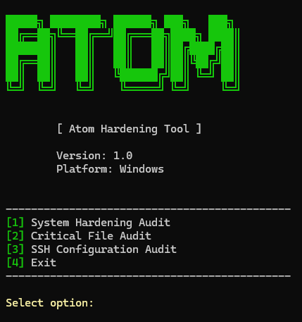
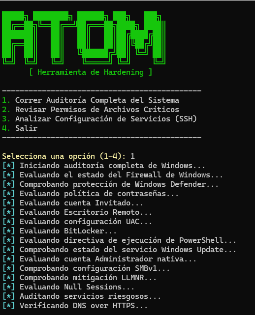
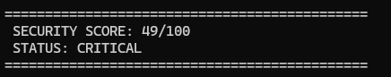
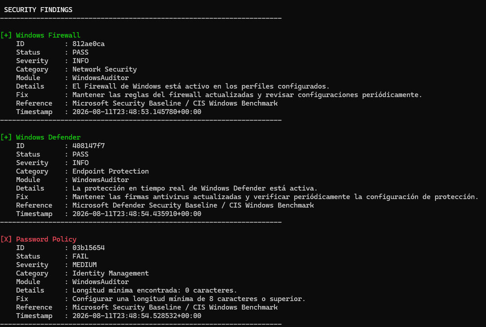
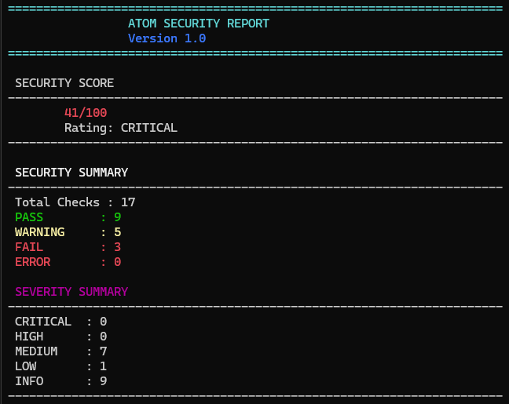
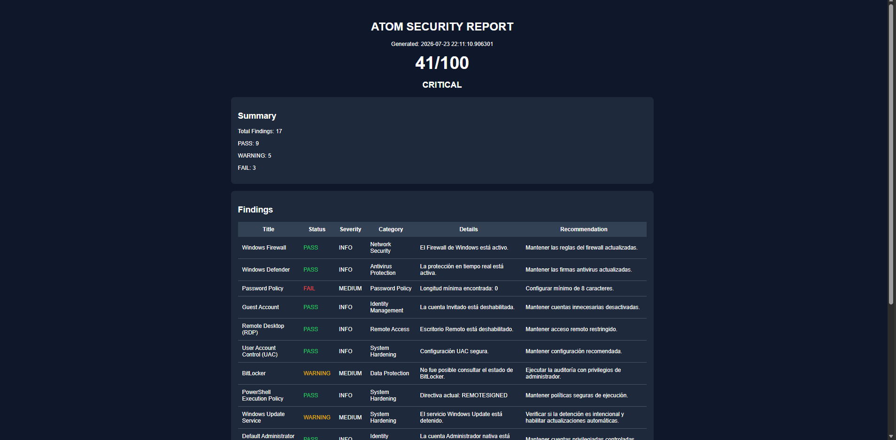

<div align="center">
  <h1>⚛ Atom Hardening Tool</h1>
  <p><b>Automated Security Auditing and Hardening Framework for Windows and Linux</b></p>

  [](https://www.python.org/)
  [](https://opensource.org/licenses/MIT)
  []()
  []()
  [](https://github.com/GaboX280/Atom-Hardening/actions)
  []()
</div>

---

## 1. Overview

**Atom** is a modular security auditing and hardening framework designed to identify configuration weaknesses and system-level vulnerabilities on **Windows** and **Linux**.

It performs automated, in-depth configuration checks, generates normalized findings, calculates a structured **Security Score**, and exports telemetry in multiple formats (console, TXT, JSON, and HTML). The framework uses an OS-centered modular design, dynamically running security checks according to the execution environment.

---

## 2. Framework Architecture

### Directory Structure

```text
ATOM/
├── main.py                    # Main entry point (CLI + interactive menu)
├── AtomHardening.spec         # PyInstaller build configuration
├── config.json                # Project configuration
├── pytest.ini                 # Test configuration
├── requirements.txt
├── atom_core/
│   ├── auditor_factory.py     # Automatic OS detection
│   ├── base_auditor.py        # Shared base class for all auditors
│   ├── core/
│   │   ├── security_score.py  # Security score calculation
│   │   └── security_summary.py
│   ├── interface/
│   │   └── interface.py       # Menu user interface
│   ├── models/
│   │   └── finding.py         # Finding data model
│   ├── reporters/
│   │   ├── console_reporter.py
│   │   ├── text_reporter.py
│   │   ├── json_reporter.py
│   │   └── html_reporter.py
│   ├── runners/
│   │   └── audit_runner.py    # Audit orchestrator
│   ├── utils/
│   │   └── distro.py
│   └── audits/
│       ├── windows/           # Windows auditor and checks
│       └── linux/             # Linux auditor and checks
├── tests/                     # Unit test suite (23 tests)
└── dist/
    └── AtomHardening.exe      # Standalone Windows executable
```

### Execution Pipeline

```text
[ START ] → main.py → AuditRunner → AuditorFactory
                                         |
              +--------------------------+
              |
              ▼
     [ OS DETECTED ] → (WindowsAuditor | LinuxAuditor)
                                |
                                ▼
                        Security Checks
                                |
                                ▼
                        Finding Objects
                                |
              +-----------------+-----------------+
              |                                   |
              ▼                                   ▼
       SecurityScore                      SecuritySummary
              |                                   |
              +-----------------+-----------------+
                                |
                                ▼
               (Console | TXT | JSON | HTML)
```

---

## 3. Auditing Capabilities

The framework automatically detects the operating system and loads the corresponding auditing module.

### Supported Security Checks

| Category | Windows | Linux |
| :--- | :--- | :--- |
| **System Identity** | Administrator and Guest accounts | Users and accounts |
| **Access Control** | UAC, PowerShell policy, passwords | Root login, authentication protocols |
| **Network and Communications** | Firewall, SMBv1, LLMNR | Linux firewall, network services |
| **Defense Mechanisms** | Windows Defender, BitLocker | System services |
| **Configuration** | Updates, DNS over HTTPS | Critical system settings |
| **File Security** | NTFS permissions | Sensitive files and permissions |
| **SSH** | SSH configuration | SSH service status and configuration |

---

## 4. Telemetry and Reports

Atom generates standardized output in four formats. The default output directory is `~/Desktop/Atom Logs`, which can be changed using the `--output-dir` flag.

| Report Type | Main Purpose | Features |
| :--- | :--- | :--- |
| **Console** | Real-time operation | Severity colors (PASS, FAIL, WARNING) |
| **TXT** | Local logging | Structured plain-text files for persistent logs |
| **JSON** | Automation / SIEM | Normalized schema for ingestion into APIs and backends |
| **HTML** | Executive dashboards | Graphical interface with findings table and score |

### Finding Schema

```json
{
    "title": "Windows Firewall",
    "status": "PASS",
    "severity": "INFO",
    "category": "Network Security",
    "module": "WindowsAuditor",
    "recommendation": "Keep the firewall enabled.",
    "reference": "CIS 1.2",
    "timestamp": "2026-10-15T10:30:00Z"
}
```

---

## 5. Security Score

The framework measures a system's security posture using a progressive **Security Score** algorithm. Deductions are applied according to the severity of each finding.

> **SECURITY SCORE: 78/100**  
> **STATUS: MODERATE**

| Severity Level | Deduction |
| :--- | :--- |
| **CRITICAL** | -25 points |
| **HIGH** | -15 points |
| **MEDIUM** | -8 points |
| **LOW** | -3 points |
| **INFO** | 0 points |

---

## 6. Installation and Usage

### Prerequisites

- **Windows:** Elevated privileges (Administrator).
- **Linux:** Root privileges (use `sudo`).
- Python 3.10 or later.

### Option A — Standalone Executable (Recommended)

Download `AtomHardening.exe` from `dist/` — **Python does not need to be installed**.

```powershell
# Windows: run a full scan
.\AtomHardening.exe --scan

# Save only a JSON report to a custom directory
.\AtomHardening.exe --scan --format json --output-dir C:\my-reports
```

### Option B — From Source

```bash
git clone https://github.com/GaboX280/Atom-Hardening.git
cd Atom-Hardening
pip install pyfiglet
```

```bash
# Interactive mode (menu)
python main.py

# Run a scan directly, without the menu
python main.py --scan
```

---

## 7. CLI Flag Reference

```text
usage: main.py [-h] [-s] [-f {all,json,html,text,txt}] [-o OUTPUT_DIR] [-q] [-v]
               {audit,list,config} ...

ATOM - Automated Security Auditing and Hardening Framework

Main flags:
  -s, --scan            Run a scan directly without the interactive menu
  -f, --format          Report format: all | json | html | text | txt (default: all)
  -o, --output-dir      Custom directory for report output
  -q, --quiet           Quiet mode (suppresses the banner and decorative messages)
  -v, --version         Show the ATOM version and exit

Subcommands:
  audit                 Run an audit (automatic or interactive mode)
  list                  List available audits
  config                Show the current configuration (config.json)
```

### Quick Examples

```bash
# Show the version
python main.py --version
# → ATOM v1.2.0

# List available audits
python main.py list

# Quiet scan, HTML output only, in a custom directory
python main.py --scan --format html --output-dir ./reports --quiet

# Full interactive mode (default)
python main.py
```

---

## 8. Screenshots and Output

| Stage | Preview |
| :--- | :--- |
| **Main Interface** |  |
| **Audit Execution** |  |
| **Security Score** |  |
| **Terminal Summary** |  |
| **TXT/JSON Report** |  |
| **HTML Report** |  |

---

## 9. Unit Tests

The test suite covers critical framework components. All tests run automatically in CI on each push.

```bash
# Run the complete test suite (23 tests)
python -m pytest

# Type checking
mypy .

# Linting
ruff check .
```

| Test File | Coverage |
| :--- | :--- |
| `test_cli.py` | CLI flags, `--scan`, `--version`, `--format` |
| `test_auditor_factory.py` | OS detection, `WindowsAuditor`, `LinuxAuditor` |
| `test_base_auditor.py` | `add_finding`, `clear_report`, `command_exists` |
| `test_finding.py` | Finding model, `to_dict`, `__str__` |
| `test_reporters.py` | JSON, TXT, HTML, and console reporters |
| `test_security_summary.py` | Aggregation of findings by status and severity |
| `test_security_score.py` | Score calculation and classification |

---

## 10. Building the Executable

To generate `dist/AtomHardening.exe` from source:

```bash
pip install pyinstaller
pyinstaller --clean AtomHardening.spec
```

The resulting executable is self-contained — it includes all `atom_core` modules, pyfiglet fonts, and `config.json`.

---

## 11. Roadmap

**Completed:**

- ✅ OS-centered modular architecture.
- ✅ Audit subsystems for Windows and Linux.
- ✅ Automatic OS detection.
- ✅ Multi-format reports (JSON, HTML, TXT, console).
- ✅ Centralized data model (`Finding`).
- ✅ Unit test suite (23 tests, CI/CD with GitHub Actions).
- ✅ Full CLI flags (`--scan`, `--format`, `--output-dir`, `--quiet`, `--version`).
- ✅ Standalone `AtomHardening.exe` built with PyInstaller.
- ✅ Code comments translated into Spanish.

**Development Roadmap:**

- ⬜ CIS benchmark mapping.
- ⬜ CVE/CIS cross-references for each finding.
- ⬜ Plugin subsystem for custom checks.
- ⬜ Expanded web dashboard.
- ⬜ Filter audits by category.

---

## 12. Legal Notice

**Atom** is an open-source framework developed exclusively for educational research and authorized security posture assessments. Automated auditing and hardening scripts must be run only on infrastructure you own or on environments for which you have explicit authorization. The repository maintainer assumes no responsibility for unauthorized use.
